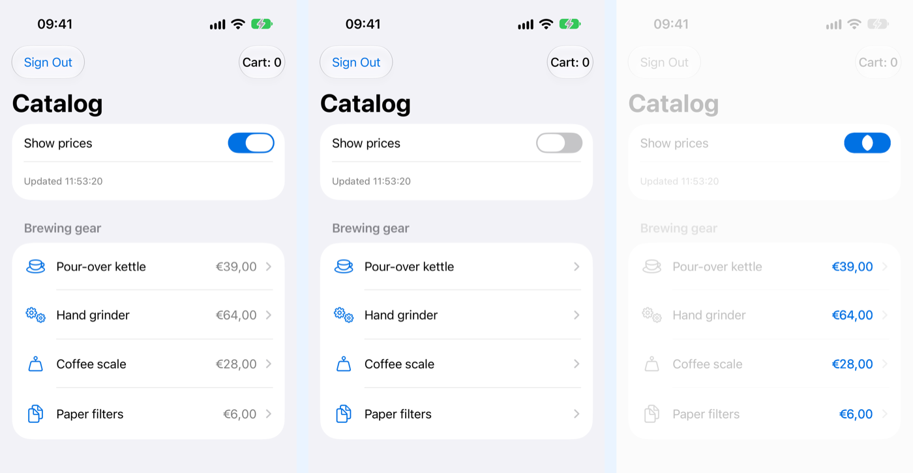

<!-- i18n-source: README.md@f538d6e779afe3cd003645722b6571419027f952 status=reviewed -->
<!-- brand:start -->

<p align="center"><picture><source media="(prefers-color-scheme: dark)" srcset="https://raw.githubusercontent.com/muhittincamdali/iOS-Testing-Automation-Framework/main/.github/brand/banner-ja-dark.svg"><source media="(prefers-color-scheme: light)" srcset="https://raw.githubusercontent.com/muhittincamdali/iOS-Testing-Automation-Framework/main/.github/brand/banner-ja-light.svg"></picture></p>

<!-- lang-selector:start -->
<p align="center"><a href="README.md">English</a> · <a href="README.tr.md">Türkçe</a> · <a href="README.zh-CN.md">简体中文</a> · <a href="README.ja.md">日本語</a> · <a href="README.ko.md">한국어</a> · <a href="README.es.md">Español</a> · <a href="README.de.md">Deutsch</a> · <a href="README.fr.md">Français</a> · <a href="README.pt-BR.md">Português (Brasil)</a> · <a href="README.ru.md">Русский</a></p>
<!-- lang-selector:end -->

<p align="center">
<a href="https://github.com/muhittincamdali/iOS-Testing-Automation-Framework/actions/workflows/ci.yml"></a>
<a href="https://github.com/muhittincamdali/iOS-Testing-Automation-Framework/releases"><picture><source media="(prefers-color-scheme: dark)" srcset="https://raw.githubusercontent.com/muhittincamdali/iOS-Testing-Automation-Framework/main/.github/brand/badge-version-dark.svg"><source media="(prefers-color-scheme: light)" srcset="https://raw.githubusercontent.com/muhittincamdali/iOS-Testing-Automation-Framework/main/.github/brand/badge-version-light.svg"></picture></a>
<a href="https://github.com/muhittincamdali/iOS-Testing-Automation-Framework/blob/main/Package.swift"><picture><source media="(prefers-color-scheme: dark)" srcset="https://raw.githubusercontent.com/muhittincamdali/iOS-Testing-Automation-Framework/main/.github/brand/badge-platforms-dark.svg"><source media="(prefers-color-scheme: light)" srcset="https://raw.githubusercontent.com/muhittincamdali/iOS-Testing-Automation-Framework/main/.github/brand/badge-platforms-light.svg"></picture></a>
<a href="https://github.com/muhittincamdali/iOS-Testing-Automation-Framework/blob/main/Package.swift"><picture><source media="(prefers-color-scheme: dark)" srcset="https://raw.githubusercontent.com/muhittincamdali/iOS-Testing-Automation-Framework/main/.github/brand/badge-language-dark.svg"><source media="(prefers-color-scheme: light)" srcset="https://raw.githubusercontent.com/muhittincamdali/iOS-Testing-Automation-Framework/main/.github/brand/badge-language-light.svg"></picture></a>
<a href="https://github.com/muhittincamdali/iOS-Testing-Automation-Framework/blob/main/LICENSE"><picture><source media="(prefers-color-scheme: dark)" srcset="https://raw.githubusercontent.com/muhittincamdali/iOS-Testing-Automation-Framework/main/.github/brand/badge-license-dark.svg"><source media="(prefers-color-scheme: light)" srcset="https://raw.githubusercontent.com/muhittincamdali/iOS-Testing-Automation-Framework/main/.github/brand/badge-license-light.svg"></picture></a>
</p>

<p align="center">
<a href="#クイックスタート"><picture><source media="(prefers-color-scheme: dark)" srcset="https://raw.githubusercontent.com/muhittincamdali/iOS-Testing-Automation-Framework/main/.github/brand/button-start-ja-dark.svg"><source media="(prefers-color-scheme: light)" srcset="https://raw.githubusercontent.com/muhittincamdali/iOS-Testing-Automation-Framework/main/.github/brand/button-start-ja-light.svg"></picture></a>
<a href="https://muhittincamdali.github.io/iOS-Testing-Automation-Framework/documentation/iostestingautomationframework/"><picture><source media="(prefers-color-scheme: dark)" srcset="https://raw.githubusercontent.com/muhittincamdali/iOS-Testing-Automation-Framework/main/.github/brand/button-docs-ja-dark.svg"><source media="(prefers-color-scheme: light)" srcset="https://raw.githubusercontent.com/muhittincamdali/iOS-Testing-Automation-Framework/main/.github/brand/button-docs-ja-light.svg"></picture></a>
<a href="https://github.com/muhittincamdali/iOS-Testing-Automation-Framework/tree/main/Examples"><picture><source media="(prefers-color-scheme: dark)" srcset="https://raw.githubusercontent.com/muhittincamdali/iOS-Testing-Automation-Framework/main/.github/brand/button-examples-ja-dark.svg"><source media="(prefers-color-scheme: light)" srcset="https://raw.githubusercontent.com/muhittincamdali/iOS-Testing-Automation-Framework/main/.github/brand/button-examples-ja-light.svg"></picture></a>
</p>

> このドキュメントは英語版 README の翻訳です。内容が異なる場合は英語版が最新です。

<!-- brand:end -->

iOS・macOS アプリの UI テストとユニットテストのための Swift パッケージです。XCUITest では、ロボット（画面ごとに 1 つのクラスで、メソッドが待機し、ステップを記録し、失敗をあなたのコードの行で報告します）、アクセシビリティ識別子が変わっても動き続ける要素の検索、アクセシビリティ監査、差分画像付きのスクリーンショット比較、CI 向けの JUnit と Markdown のレポートを追加します。Swift Testing でも XCTest でも、あらゆるテストで SwiftUI のスナップショット、ポーリング待機、リトライ、スパイ、シード付きのテストデータを利用できます。小さな UI の変更で UI テストが壊れてしまうチームや、CI ログで読みにくいと感じているチームに向いています。パッケージは依存関係を持たず、テストターゲットにだけ追加します。

## 主な特長

- **読みやすい UI テスト** — ロボットは `app.buttons["signIn.submit"].tap()` のような操作の並びを
  `app.on(SignInRobot.self).signIn(email:password:)` に置き換えます。各ステップは要素がタップできるようになるまで待機し、Xcode のテストレポートに名前付きのステップとして表示されます。
- **自己修復するロケーター** — 識別子が変更されると、ラベル、プレースホルダー、または似た識別子で要素を見つけ、必要な修正をログに記録します。2 つの要素が同じ程度に一致する場合は、推測を行いません。
- **目で確認できるビジュアルリグレッション** — スクリーンショットと SwiftUI ビューを、許容誤差、無視する領域（時計や日付など）、変化したピクセルがすべて青で示される差分画像とともに、基準の PNG と比較します。
- **毎回の実行でアクセシビリティを確認** — 1 回の呼び出しで、ラベルのないコントロール、44 × 44 ポイント未満のタッチターゲット、要素の種類を繰り返すラベル、重複した識別子を画面から検出します。Apple の `performAccessibilityAudit()` を加えることもできます。
- **CI で使える出力** — テストバンドルごとに `junit.xml` と Markdown のジョブサマリーを出力します。入力されたパスワードやトークンはマスクされ、複数回の実行にわたる不安定なテストの分析も行えます。
- **テスト済みのルール** — 修復、監査、画像比較、レポート、マスク処理は純粋な Swift で、macOS と iPhone シミュレーター上の 118 個の Swift Testing テストでカバーされています。[サンプルアプリ](Examples/AutomationShowcase)の 9 個の UI テストが、CI で XCUITest 層をエンドツーエンドで実行します。

### 含まれるもの

| 領域                     | 型                                                                                                                                                                       |
| ------------------------ | ------------------------------------------------------------------------------------------------------------------------------------------------------------------------ |
| UI テスト                | `Robot`, `Locator`, `LocatorHealer`, `HealingLog`, `XCUIElement.element(_:)`, `waitForHittable`, `waitForDisappearance`, `waitForLabel`, `waitForValue`, `descriptors()` |
| アクセシビリティ         | `AccessibilityAudit`, `Robot.assertAccessible()`, `XCUIElement.accessibilityIssues()`, `ContrastRatio`                                                                   |
| 画像                     | `assertSnapshot(of:)`, `Robot.assertScreenshot(named:)`, `SnapshotStore`, `ImageComparator`, `Bitmap`, `ViewRenderer`                                                    |
| レポート                 | `TestResultCollector`, `TestReport` (JUnit XML, Markdown), `TestResult`, `Redactor`, `FlakinessAnalyzer`                                                                 |
| ユニットテスト用ヘルパー | `Wait`, `RetryPolicy`, `Spy`, `ThrowingSpy`, `Fixtures`, `Benchmark`                                                                                                     |

## クイックスタート

**1. パッケージを追加する**

Xcode で **File › Add Package Dependencies…** を選び、リポジトリの URL を入力します。

```text
https://github.com/muhittincamdali/iOS-Testing-Automation-Framework.git
```

ウィンドウ右上の検索欄に貼り付けます。**Dependency Rule** は `2.0.0` からの **Up to Next Major Version** のままにして、**Add Package** をクリックします。次のウィンドウで、**iOSTestingAutomationFramework** の横にある **UI テストターゲット**を選び（アプリのターゲットではありません。パッケージは XCTest をリンクします）、もう一度 **Add Package** をクリックします。

UI テストターゲットがまだありませんか？ **File › New › Target… › UI Testing Bundle** を選んでください。

**2. モジュールをインポートする**

```swift
import iOSTestingAutomationFramework
```

この行は UI テストファイルの先頭、`import XCTest` の下に置きます。

**3. 使ってみる**

新しい Xcode アプリ（**File › New › Project… › App**、**Include Tests** にチェック）で、`ContentView.swift` の中身をすべて次の内容に置き換えます。

```swift
import SwiftUI

struct ContentView: View {
    @State private var count = 0

    var body: some View {
        VStack(spacing: 16) {
            Text("Tapped \(count) times")
                .accessibilityIdentifier("counter.label")
            Button("Tap me") { count += 1 }
                .buttonStyle(.borderedProminent)
                .accessibilityIdentifier("counter.button")
        }
    }
}
```

次に、UI テストファイル（名前が `UITests.swift` で終わるもの）の内容を次のように置き換えます。

```swift
import XCTest
import iOSTestingAutomationFramework

final class CounterRobot: Robot {
    var label: XCUIElement { app.staticTexts["counter.label"] }
    var button: XCUIElement { app.buttons["counter.button"] }
}

final class CounterUITests: XCTestCase {
    @MainActor
    func testTappingCounts() {
        let app = XCUIApplication()
        app.launch()

        let counter = app.on(CounterRobot.self)
        counter
            .tap(counter.button)
            .tap(counter.button)
            .assertLabel(of: counter.label, equals: "Tapped 2 times")
    }
}
```

**⌘U** を押します。テストはシミュレーターでアプリを起動し、ボタンを 2 回タップして成功します。テストレポートでは、各タップとラベルの確認がそれぞれ独立したステップとして表示されます。

## インストール

### Swift Package Manager

Xcode で **File › Add Package Dependencies…** を選び、リポジトリの URL を入力します。

```text
https://github.com/muhittincamdali/iOS-Testing-Automation-Framework.git
```

`Package.swift` では、依存関係を追加し、プロダクトをテストターゲットの下に指定します。

```swift
dependencies: [
    .package(url: "https://github.com/muhittincamdali/iOS-Testing-Automation-Framework.git", from: "2.0.0")
],
targets: [
    .testTarget(name: "YourAppTests", dependencies: [
        .product(name: "iOSTestingAutomationFramework", package: "iOS-Testing-Automation-Framework")
    ])
]
```

## 使い方

UI テストのサンプルは[サンプルアプリの UI テスト](Examples/AutomationShowcase/AutomationShowcaseUITests)から、ユニットテストのサンプルは
[`ReadmeExamples.swift`](Tests/iOSTestingAutomationFrameworkTests/ReadmeExamples.swift) から引用しています。CI は両方を実行します。

### 画面ごとにロボットを書く

```swift
final class SignInRobot: Robot {
    var email: XCUIElement { app.textFields["signIn.email"] }
    var password: XCUIElement { app.secureTextFields["signIn.password"] }
    var submit: XCUIElement { app.element(Locator("signIn.submit", label: "Sign In", kind: .button)) }
    var error: XCUIElement { app.staticTexts["signIn.error"] }

    @discardableResult
    func signIn(email address: String, password secret: String) -> CatalogRobot {
        type(address, into: email)
        typeSecret(secret, into: password)
        tap(submit)
        return on(CatalogRobot.self)
    }
}
```

これで、テストはテストケースの手順のように読めます。

```swift
app.on(SignInRobot.self)
    .signIn(email: "ada@example.com", password: "correct-horse-battery")
    .assertCart(contains: 0)
    .open("grinder")
    .addToCart(times: 2)
    .goBack()
    .assertCart(contains: 2)
```

`typeSecret(_:into:)` はパスワードを登録するため、ステップ名、失敗メッセージ、レポートでは `••••` とマスクされます。XCTest は入力したテキストを自身のステップに記録し、そこにはどのマスク処理も届かないため、パスワードは入力せずに貼り付けます。貼り付けた後、ペーストボードは空になります。

### 識別子が変わってもテストを動かし続ける

`Locator` は識別子と、人が目にするラベルまたはプレースホルダーを保持します。次のテストでは、リデザイン前の識別子をそのまま使っています。

```swift
// "loginButton" was the identifier before the redesign; the app now uses "signIn.submit".
let button = app.element(Locator("loginButton", label: "Sign In", kind: .button), timeout: 1)
XCTAssertTrue(button.exists)
XCTAssertEqual(button.identifier, "signIn.submit")
```

修復された検索は、修正案とともに `HealingLog` と Markdown レポートに記録されます。修正案は次のとおりです。
`Update the locator "loginButton" to "signIn.submit"`

### アクセシビリティを監査する

```swift
app.on(SignInRobot.self).assertAccessible()
```

問題はそれぞれテストの失敗になります。問題を自分で調べるには次のようにします。

```swift
let issues = try app.accessibilityIssues()
let favoriteIssues = issues.filter { $0.element.identifier == "audit.favorite" }.map(\.rule)
XCTAssertEqual(Set(favoriteIssues), [.missingLabel, .smallTouchTarget])
```

### スクリーンショットを比較する

`assertScreenshot(named:of:ignoring:)` は、アプリ（または 1 つの要素）を、テストファイルの隣の `__Snapshots__/` に保存された基準の PNG と比較します。自然に変化する要素は除外できます。

```swift
catalog.assertScreenshot(named: "catalog", ignoring: [catalog.lastUpdated], comparator: comparator, store: store)
```

最初の実行では基準画像を記録して失敗するため、基準画像がないのに黙って成功することはありません。不一致の場合は、基準画像、実際のスクリーンショット、差分画像がテストレポートに添付されます。

### ユニットテストで SwiftUI ビューのスナップショットを取る

```swift
@Test @MainActor func signalBarsLookRight() throws {
    try assertSnapshot(of: SignalBars(level: 3), named: "signal-bars-3", size: CGSize(width: 44, height: 32))
}
```

`assertSnapshot` は問題を記録する代わりにエラーを投げるため、Swift Testing でも XCTest でも同じように動作します。

### 非同期の状態を待ち、フェイクを確認する

```swift
struct FakeUserService: UserService {
    let fetchUser = ThrowingSpy<Int, String>(returning: "Ada")

    func user(id: Int) async throws -> String {
        try fetchUser(id)
    }
}

@Test @MainActor func profileLoadsTheUser() async throws {
    let service = FakeUserService()
    let model = ProfileModel(service: service)

    model.load(id: 42)

    try await Wait.until("the name to load") { model.name == "Ada" }
    #expect(service.fetchUser.inputs == [42])
}
```

### CI で結果をレポートする

コレクターを UI テストバンドルに一度だけ設定します。

```swift
override class func setUp() {
    super.setUp()
    // Writes junit.xml and summary.md when TESTING_AUTOMATION_REPORT_DIR is set.
    TestResultCollector.install(reportName: "AutomationShowcase UI tests")
}
```

そして、テストを実行するときにレポートのフォルダーを指定します。

```sh
TEST_RUNNER_TESTING_AUTOMATION_REPORT_DIR="$PWD/reports" xcodebuild test \
  -scheme AutomationShowcase -destination 'platform=iOS Simulator,name=iPhone 17 Pro'
cat reports/summary.md >> "$GITHUB_STEP_SUMMARY"   # on GitHub Actions
```

自分の結果からレポートを作るには次のようにします。

```swift
let report = TestReport(name: "Nightly", results: results)
let xml = report.junitXML()
```

## デモ

iPhone 17 Pro シミュレーター上の [AutomationShowcase](Examples/AutomationShowcase) アプリです。ビジュアルリグレッションテストは価格を隠して画面を基準画像と比較します。3 枚目の画像はパッケージが描画した差分画像で、変化したピクセルがすべて青で表示されています。画像はそのテストが保存し、
[`scripts/generate-screenshots.sh`](scripts/generate-screenshots.sh) が縮小しています。

<p align="center"><picture><source media="(prefers-color-scheme: dark)" srcset="docs/images/visual-diff-dark.png"></picture></p>

UI テストを自分で実行するには、[`Examples/AutomationShowcase`](Examples/AutomationShowcase) の `AutomationShowcase.xcodeproj` を開き、iPhone シミュレーターを選んで **⌘U** を押します。各テストが示す内容は [Examples/README.md](Examples/README.md) に一覧があります。

## ドキュメント

API リファレンスと解説記事：

- [API リファレンス](https://muhittincamdali.github.io/iOS-Testing-Automation-Framework/documentation/iostestingautomationframework/)
  （DocC。`main` から GitHub Pages に公開されます）
- ローカルでは、Xcode の **Product › Build Documentation** でビルドするか、コマンドラインから実行します。

```sh
xcodebuild docbuild -scheme iOSTestingAutomationFramework -destination 'generic/platform=iOS Simulator'
```

## ガイド

- [Getting Started](https://muhittincamdali.github.io/iOS-Testing-Automation-Framework/documentation/iostestingautomationframework/gettingstarted)
  — パッケージをテストターゲットに追加し、最初のロボットテストと最初のユニットテストを書きます
  （[ソース](Sources/iOSTestingAutomationFramework/iOSTestingAutomationFramework.docc/GettingStarted.md)）。
- [Writing UI Tests with Robots](https://muhittincamdali.github.io/iOS-Testing-Automation-Framework/documentation/iostestingautomationframework/writinguitestswithrobots)
  — ロボットのチェーン、自己修復ロケーター、待機、アクセシビリティ監査
  （[ソース](Sources/iOSTestingAutomationFramework/iOSTestingAutomationFramework.docc/WritingUITestsWithRobots.md)）。
- [Comparing Screenshots](https://muhittincamdali.github.io/iOS-Testing-Automation-Framework/documentation/iostestingautomationframework/comparingscreenshots)
  — SwiftUI のスナップショット、UI テストのスクリーンショット、許容誤差、記録モード
  （[ソース](Sources/iOSTestingAutomationFramework/iOSTestingAutomationFramework.docc/ComparingScreenshots.md)）。
- [Reporting on CI](https://muhittincamdali.github.io/iOS-Testing-Automation-Framework/documentation/iostestingautomationframework/reportingonci)
  — JUnit XML、ジョブサマリー、マスク処理、不安定なテスト
  （[ソース](Sources/iOSTestingAutomationFramework/iOSTestingAutomationFramework.docc/ReportingOnCI.md)）。

## 動作要件

| プラットフォーム | 最小バージョン        |
| ---------------- | --------------------- |
| iOS              | 17                    |
| macOS            | 14                    |
| ツールチェーン   | Swift 6.2 · Xcode 26+ |

XCUITest のヘルパーには UI テストターゲットが必要です。そのほかのヘルパーは任意のテストターゲットで動作します。CI は GitHub の `macos-26` ランナーイメージに入っている標準の Xcode でビルドします。パッケージ自体は Xcode 27 で開発しています。

## アーキテクチャ

- `Sources/iOSTestingAutomationFramework/` には、領域ごとに 1 つのフォルダーがあります：`Core`、`Reporting`、`Waiting`、`Resilience`、`Locators`、`Accessibility`、`Visual`、`Doubles`、`Fixtures`、`Performance`、`XCUI`。
- `XCUI` 以外はすべて純粋な Swift です。ルール（修復、監査、画像比較、レポート、マスク処理）は `ElementDescriptor` や `Bitmap` といった値に対して動作するので、ユニットテストはアプリを起動せずにそれらをカバーできます。`XCUI` は薄い層で、画面の 1 回のスナップショットを記述子に変換し、XCTest を通じて失敗を報告します。
- パッケージは Swift Testing をインポートしません。Xcode は UI テストバンドルを Swift Testing が使えない状態でビルドするため、依存するとすべての UI テストターゲットが壊れてしまいます。ユニットテスト向けのアサーションはエラーを投げ、どちらのフレームワークもそれを失敗として報告します。
- テストの外から入ってくる入力には上限があります。画像サイズはデコードの前に確認し、スナップショット名は安全なファイル名に変換し、NaN や無限大の数値は変換せずに範囲内に収め、スパイ、修復ログ、監査、編集距離の探索には固定の上限があります。収集したテスト結果と登録したシークレットは、実行中はすべて保持されます。
- CI は、macOS で `swift test`、iPhone シミュレーターで `xcodebuild test` を実行し、iOS と macOS 向けにビルドし、サンプルアプリの UI テストを実行して、DocC ドキュメントを公開します。

テストをローカルで実行するには次のようにします。

```sh
swift test                                    # macOS
xcodebuild test -scheme iOSTestingAutomationFramework \
  -destination 'platform=iOS Simulator,name=iPhone 17 Pro'
cd Examples/AutomationShowcase                # the UI tests
xcodebuild test -scheme AutomationShowcase \
  -destination 'platform=iOS Simulator,name=iPhone 17 Pro'
```

## ロードマップ

- 画像比較に加えて、テキストと JSON のスナップショット方式。
- 異なるマシンで撮影したスクリーンショット向けの、知覚に基づく色の許容誤差。
- パッケージを Swift Package Index に追加する。`.spi.yml` はすでにリポジトリにあります。

## コントリビューション

コントリビューションを歓迎します。pull request を作成する前に[コントリビューションガイド](https://github.com/muhittincamdali/iOS-Testing-Automation-Framework/blob/main/CONTRIBUTING.md)と[行動規範](https://github.com/muhittincamdali/.github/blob/main/CODE_OF_CONDUCT.md)をお読みください。セキュリティ上の問題は[セキュリティポリシー](https://github.com/muhittincamdali/iOS-Testing-Automation-Framework/blob/main/SECURITY.md)に従って非公開で報告してください。

## ライセンス

MIT ライセンスで公開しています。詳細は [LICENSE](LICENSE) を参照してください。
